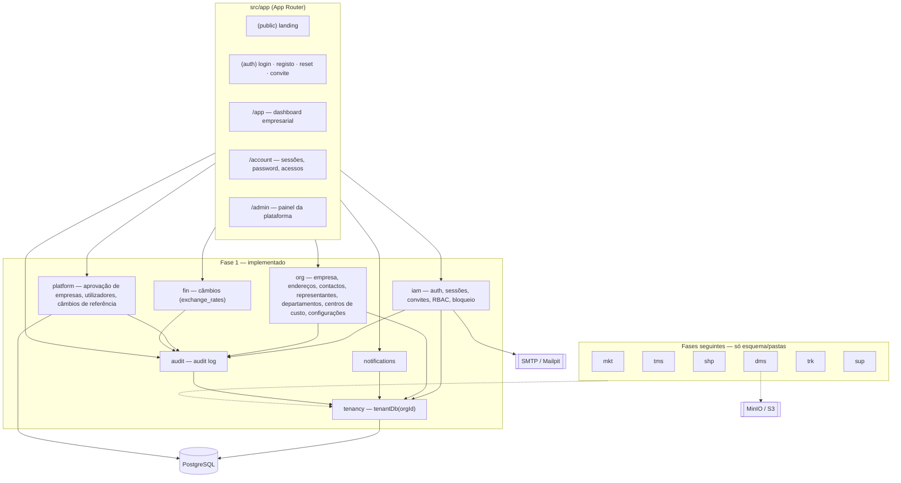

# Arquitectura

AGFF Logistics OS é um **monólito modular** Next.js 15. Cada domínio vive em `src/modules/<módulo>` com serviços (regras de negócio, sem dependência da UI), schemas Zod e server actions finas. As páginas em `src/app` só chamam actions/serviços.

## Módulos

O registo de módulos (`src/modules/registry.ts`) define a navegação: módulos activos aparecem consoante as permissões do utilizador; módulos planeados aparecem como "Disponível na fase N", sem dados fictícios.

## Camadas

| Camada   | Local                                                            | Responsabilidade                                                                           |
| -------- | ---------------------------------------------------------------- | ------------------------------------------------------------------------------------------ |
| UI       | `src/app`, `src/components`                                      | Server Components + formulários com `useActionState`; nunca são a autoridade de permissões |
| Actions  | `src/modules/*/actions.ts`                                       | Obtém o `ActorContext` da sessão, valida o input (Zod), chama o serviço, revalida a página |
| Serviços | `src/modules/*/services`                                         | Regras de negócio, `assertPermission`, transacções, audit log                              |
| Dados    | `prisma/schema/*.prisma`, `src/lib/db.ts`, `src/modules/tenancy` | Prisma + extensão de tenancy                                                               |

## Multi-tenancy

- Todas as entidades empresariais têm `organization_id` (Fase 1 e Fase 2).
- Os serviços usam `tenantDb(ctx.organizationId)` — uma extensão Prisma (`src/modules/tenancy/tenant-scope.ts`) que, para os modelos em `TENANT_SCOPED_MODELS`:
  - acrescenta `organizationId` ao `where` de leituras, updates e deletes (sobrepondo qualquer valor do chamador);
  - força `organizationId` em `create`/`createMany`/`upsert` e remove-o de `update` (impossível mover registos entre empresas);
  - limita `organization` à própria empresa e proíbe a sua criação.
- O `organizationId` vem sempre da sessão no servidor, nunca do formulário.
- Os ficheiros em MinIO usam chaves `org/<organizationId>/...` (`tenantObjectKey`).
- Prova: `tests/unit/tenant-scope.test.ts` e `tests/integration/tenant-isolation.test.ts` (a org A não lê, altera nem apaga dados da org B).

O cliente Prisma global só é usado em operações de plataforma (aprovação, listagem de empresas), sempre atrás de permissões `platform.*`.

## Identidade, sessões e RBAC

- **Auth.js v5** com provider Credentials. O JWT só transporta o id de uma linha da tabela `sessions`; cada pedido valida a sessão na BD (`validateSession`), o que permite **revogar sessões**, expirar (12 h) e invalidar todas as sessões quando a password muda ou a conta é bloqueada.
- **Membership** liga utilizador ↔ organização ↔ perfil. Um utilizador pode pertencer a várias empresas e alternar a empresa activa.
- **11 perfis** (`src/modules/iam/permissions.ts`): Super Administrator e Platform Operations (âmbito plataforma, só na organização `AGFF-PLATFORM`); Company Administrator, Logistics Manager, Procurement Officer, Document Controller, Finance Officer, Transporter Administrator, Driver, Customer e Auditor (âmbito empresa).
- O catálogo de permissões e a matriz perfil→permissões são sincronizados para a BD pelo seed (`prisma/seed-core.ts`).
- `loadActorContext` constrói o `ActorContext` (utilizador, org, perfil, permissões). Empresas não activas e membros suspensos ficam **sem permissões**.
- Cada serviço chama `assertPermission(ctx, "...")`. A UI esconde acções sem permissão, mas a autoridade é sempre o servidor.
- **Anti-escalada**: só se pode atribuir/convidar perfis do mesmo âmbito cujas permissões sejam um subconjunto das do actor.

## Auditoria

`recordAudit` (`src/modules/audit/audit.service.ts`) grava utilizador, organização, timestamp, acção, entidade, id, valores anteriores/novos, IP e user agent, na mesma transacção da mutação. Campos sensíveis (`password*`, `token*`, `secret*`) são removidos.

## Internacionalização

`next-intl` sem prefixo de rota: o locale vem do cookie `NEXT_LOCALE` (pt-PT por omissão, en). Catálogos em `messages/`. Datas no fuso `Africa/Luanda`.

## Infra-estrutura

`docker-compose.yml`: PostgreSQL 16 (BDs `agff_logistics` e `agff_logistics_test`), MinIO, Mailpit, Redis (perfil opcional) e a app (`Dockerfile`). CI em `.github/workflows/ci.yml`: lint, format, typecheck, unitários, integração (Postgres), build + Playwright (Postgres + Mailpit) e build da imagem Docker.
