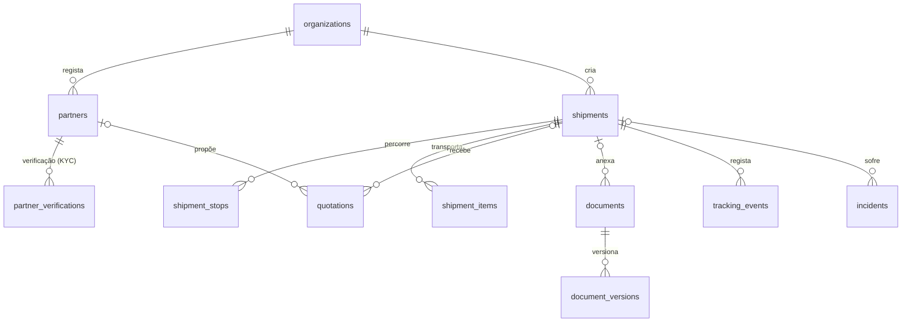

# Modelo de dados

Esquema Prisma dividido em `prisma/schema/`:

- `base.prisma` — gerador e datasource (PostgreSQL)
- `core.prisma` — Fase 1 (implementado e usado pela aplicação)
- `phase2.prisma` — Fase 2 (só tabelas, sem UI nem serviços)

Convenções: ids `cuid`, colunas `snake_case` (`@map`), tabelas no plural, `created_at`/`updated_at`. **Todas as entidades empresariais têm `organization_id`** e são filtradas por `tenantDb()`. Tabelas globais: `users`, `permissions`, `role_permissions`, `sessions`, `password_reset_tokens`, `access_logs`. `roles`, `audit_logs` e `exchange_rates` têm `organization_id` opcional (registos de sistema/plataforma ficam a `NULL`).

## Fase 1

```mermaid
erDiagram
  organizations ||--o{ organization_addresses : tem
  organizations ||--o{ organization_contacts : tem
  organizations ||--o{ organization_representatives : tem
  organizations ||--o{ departments : tem
  organizations ||--o{ cost_centers : tem
  departments |o--o{ cost_centers : agrupa
  organizations ||--o{ memberships : tem
  users ||--o{ memberships : pertence
  roles ||--o{ memberships : atribui
  departments |o--o{ memberships : aloca
  roles ||--o{ role_permissions : concede
  permissions ||--o{ role_permissions : ""
  organizations |o--o{ roles : "perfis personalizados (futuro)"
  organizations ||--o{ user_invites : emite
  roles ||--o{ user_invites : propõe
  users ||--o{ user_invites : convida
  users ||--o{ sessions : abre
  organizations |o--o{ sessions : "org activa"
  users ||--o{ password_reset_tokens : pede
  users |o--o{ access_logs : regista
  organizations |o--o{ audit_logs : regista
  users |o--o{ audit_logs : executa
  organizations |o--o{ exchange_rates : define
  organizations ||--o{ notifications : contém
  users ||--o{ notifications : recebe

  organizations {
    string id PK
    string nif UK
    string name
    string legal_name
    enum type "PLATFORM SHIPPER TRANSPORTER ..."
    enum status "PENDING_APPROVAL ACTIVE REJECTED SUSPENDED"
    string country "ISO-3166 (AO)"
    string currency "ISO-4217 (AOA)"
    json settings
  }
  users {
    string id PK
    string email UK
    string password_hash
    enum status "ACTIVE LOCKED DISABLED"
    int failed_login_attempts
    datetime locked_until
    bool mfa_enabled "pendente"
  }
  memberships {
    string id PK
    string organization_id FK
    string user_id FK
    string role_id FK
    enum status "ACTIVE SUSPENDED"
  }
  roles {
    string id PK
    string key "SUPER_ADMIN ... AUDITOR"
    enum scope "PLATFORM ORGANIZATION"
    string organization_id FK "NULL = perfil de sistema"
  }
  permissions {
    string id PK
    string key UK
  }
  user_invites {
    string id PK
    string organization_id FK
    string email
    string token_hash UK
    enum status "PENDING ACCEPTED REVOKED EXPIRED"
    datetime expires_at
  }
  sessions {
    string id PK
    string user_id FK
    string active_organization_id FK
    datetime expires_at
    datetime revoked_at
  }
  audit_logs {
    string id PK
    string organization_id FK
    string user_id FK
    string action
    string entity_type
    string entity_id
    json before
    json after
    datetime created_at
  }
  exchange_rates {
    string id PK
    string organization_id FK "NULL = referência da plataforma"
    string base_currency
    string quote_currency
    decimal rate
    date effective_date
  }
  notifications {
    string id PK
    string organization_id FK
    string user_id FK
    string type
    datetime read_at
  }
```

## Fase 2 (preparada, sem UI)

Todas estas tabelas têm `organization_id` e já estão em `TENANT_SCOPED_MODELS`. `document_versions.storage_key` usa o prefixo `org/<organizationId>/` no MinIO.
